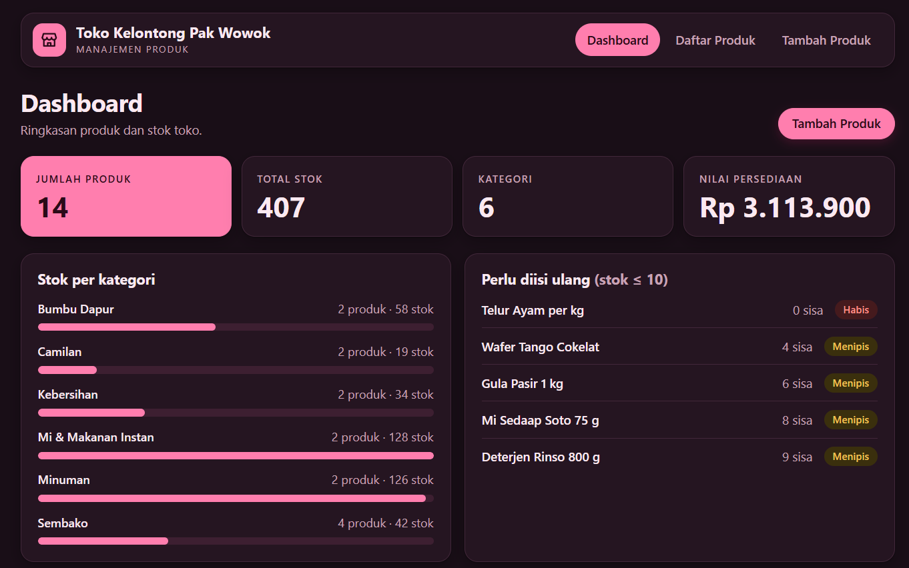
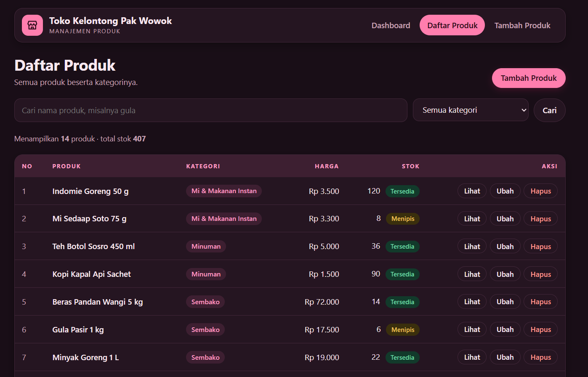
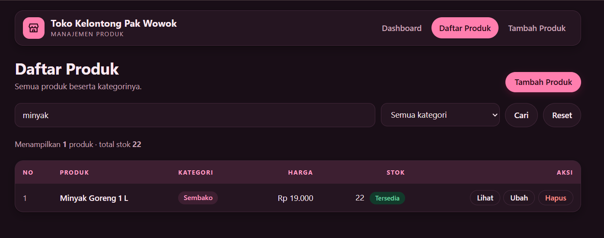
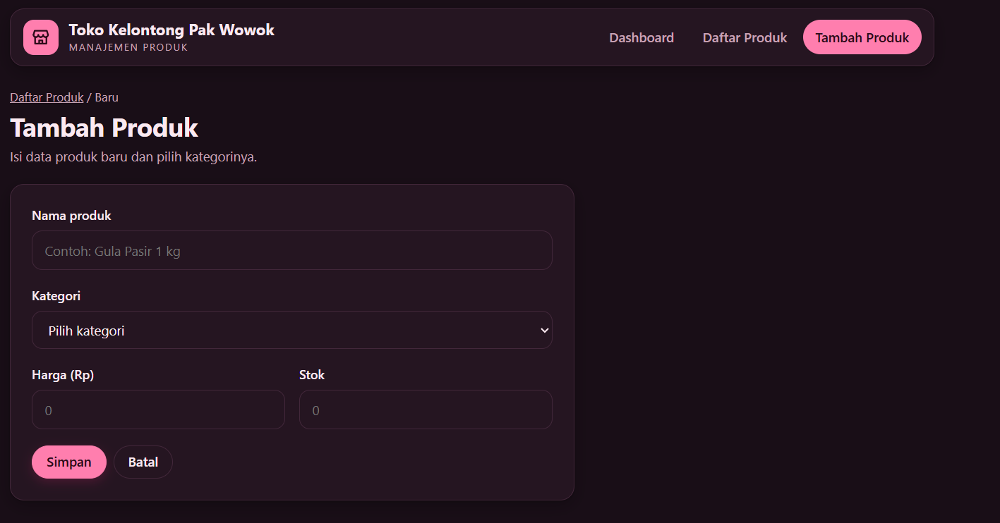
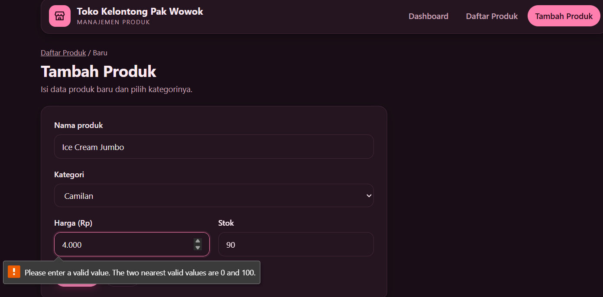
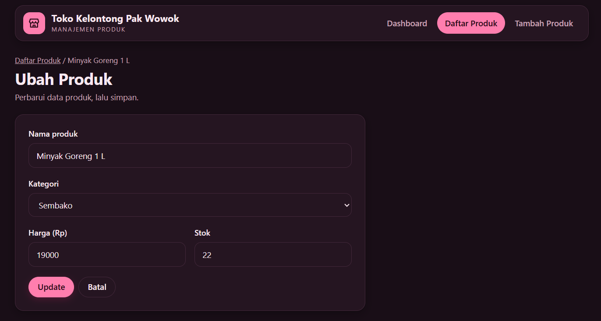
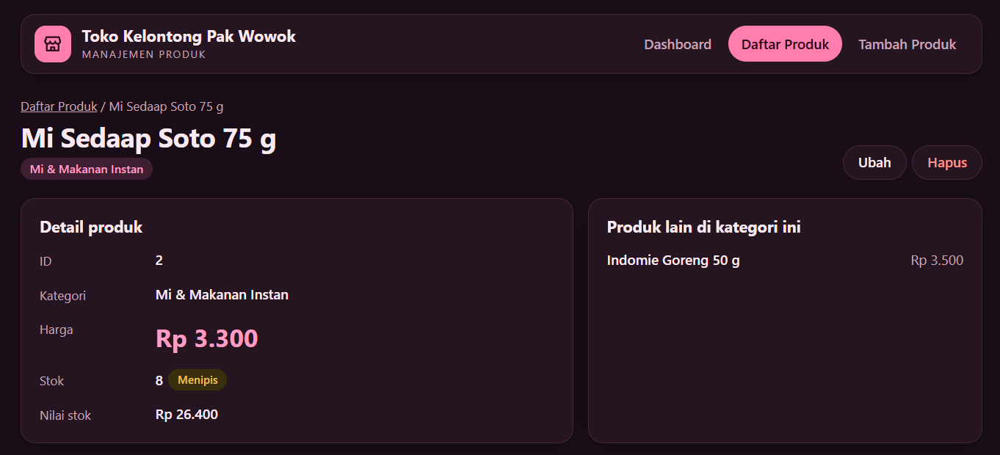

# Manajemen Produk Toko Kelontong (Laravel + Blade + Eloquent)

Folder ini berisi file aplikasi saja, bukan seluruh framework Laravel. Salin ke proyek Laravel baru (Laravel 10, 11, atau 12).

## Cara menjalankan

1. Buat proyek Laravel baru:

   ```bash
   composer create-project laravel/laravel toko-kelontong
   cd toko-kelontong
   ```

2. Salin isi folder ini ke proyek tersebut, lalu timpa file yang sudah ada (`routes/web.php` dan `database/seeders/DatabaseSeeder.php`).

3. Atur database di `.env`. Laravel 11 dan 12 memakai SQLite secara bawaan, jadi tidak perlu diubah. Untuk MySQL:

   ```
   DB_CONNECTION=mysql
   DB_DATABASE=toko_kelontong
   DB_USERNAME=root
   DB_PASSWORD=
   ```

4. Jalankan migration dan seeder (14 produk dan 6 kategori contoh):

   ```bash
   php artisan migrate --seed
   ```

5. Jalankan server, lalu buka http://127.0.0.1:8000

   ```bash
   php artisan serve
   ```

## Daftar file

| File | Fungsi |
| --- | --- |
| `database/migrations/..._create_categories_table.php` | Tabel `categories` (id, name) |
| `database/migrations/..._create_products_table.php` | Tabel `products` (id, category_id sebagai foreign key, name, price, stock) |
| `database/seeders/DatabaseSeeder.php` | Data contoh |
| `app/Models/Category.php` | Model kategori, relasi `hasMany` ke produk |
| `app/Models/Product.php` | Model produk, relasi `belongsTo` ke kategori |
| `app/Http/Controllers/DashboardController.php` | Ringkasan jumlah produk dan total stok |
| `app/Http/Controllers/ProductController.php` | Daftar, cari, tambah, detail, ubah, hapus |
| `routes/web.php` | Route dashboard dan `Route::resource('products', ...)` |
| `resources/views/layouts/app.blade.php` | Layout induk (`@yield`, `@stack`, `@include`) |
| `resources/views/partials/` | Navbar dan penanda kondisi stok (`@if`) |
| `resources/views/dashboard.blade.php` | Halaman dashboard |
| `resources/views/products/` | Daftar (`@forelse`), tambah, ubah, detail, dan kolom form bersama (`@csrf`, `@method`, `@error`) |
| `public/css/style.css` | Tampilan bertema pink |
| `ss/` | Folder tangkapan layar aplikasi |

## Fitur dan method Eloquent yang dipakai

| Fitur | Method |
| --- | --- |
| Daftar produk beserta kategori | `Product::with('category')->latest()->get()` |
| Pencarian berdasarkan nama | `->when($request->q, fn ($query, $q) => $query->where('name', 'like', "%{$q}%"))` |
| Detail produk | `Product::with('category')->findOrFail($id)` |
| Tambah produk | `Product::create($request->validate([...]))` |
| Ubah produk | `$product->update($request->validate([...]))` |
| Hapus produk | `Product::findOrFail($id)->delete()` |
| Jumlah produk dan total stok | `Product::count()` dan `Product::sum('stock')` |
| Relasi | `Category::products()` memakai `hasMany`, `Product::category()` memakai `belongsTo` |

Kondisi stok: 0 berarti Habis, 10 atau kurang berarti Menipis, selain itu Tersedia.

## Screenshot

### Dashboard



### Daftar produk



### Pencarian produk



### Tambah produk



### Validasi error



### Ubah produk



### Detail produk


